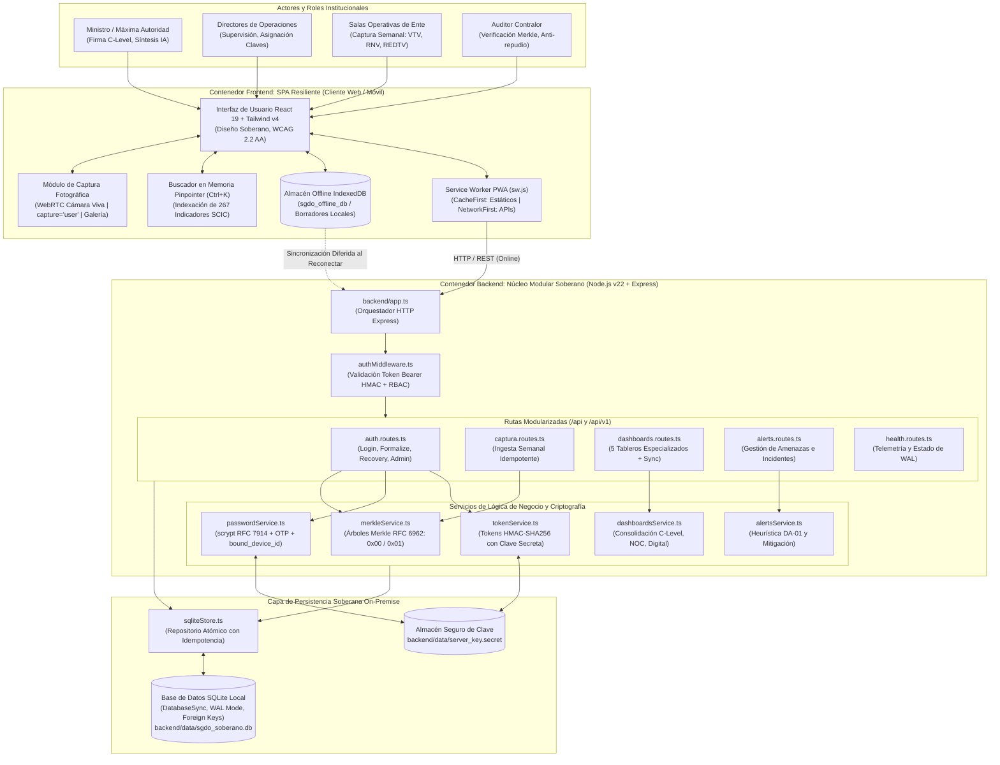
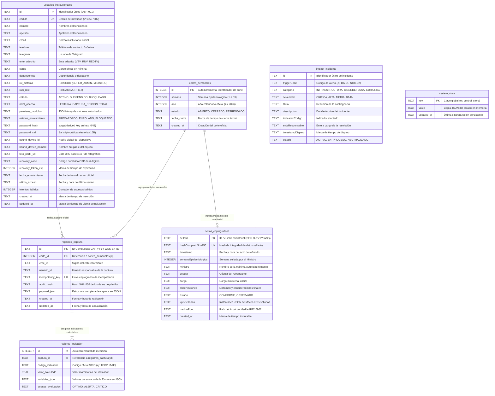
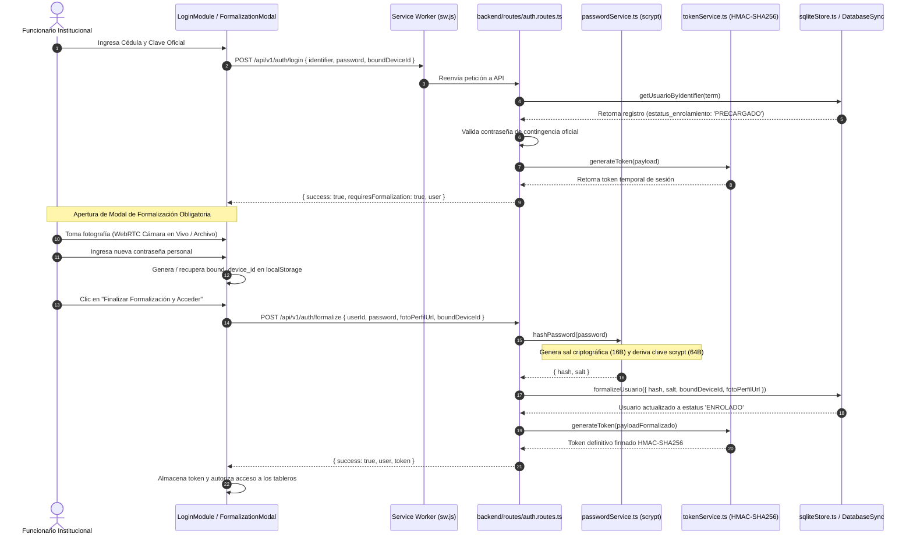
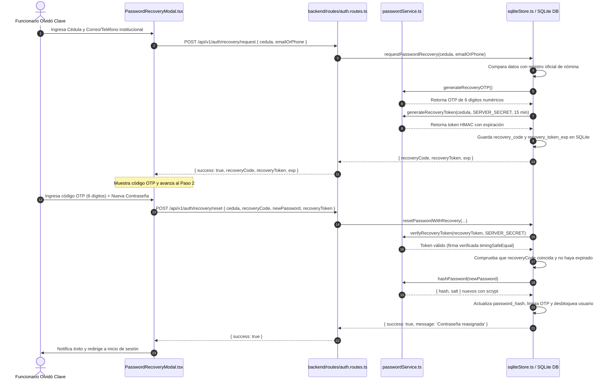
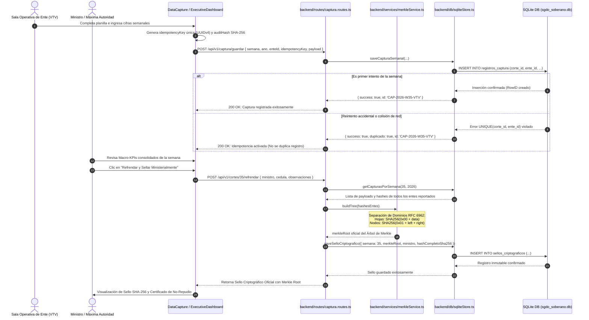

# Arquitectura y Estructura del Sistema SGDO-VSCC
## Sistema de Gestión y Despliegue Operativo (Vicepresidencia Sectorial de Comunicación y Cultura / MIPPCI)
**Archivo Maestro:** `ARCHITECTURE.md`  
**Propósito:** Especificación de referencia técnica integral, Modelo C4, mapa de componentes, modelo entidad-relación (ERD), máquina de estados y diagramas de secuencia para guiar el desarrollo continuo (*vibe coding*) sin mezclar responsabilidades ni romper dependencias.

---

## 1. Arquitectura y Estructura (El Panorama General)

### 1.1 Diagrama de Arquitectura de Alto Nivel (Modelo C4 - Nivel 2: Contenedores)
Este diagrama delimita con precisión las responsabilidades de cada contenedor lógico, garantizando que la interfaz cliente no asuma lógica de negocio crítica ni el backend dependa de servicios externos fuera de la infraestructura soberana.



---

### 1.2 Diagrama de Componentes y Dependencias Internas (Dependency Graph)
Este mapa visualiza qué archivo importa a cuál en el árbol del proyecto, evitando referencias circulares y facilitando la depuración rápida (*vibe coding*).

```mermaid
graph TD
    subgraph FrontendTree["Árbol de Componentes Frontend (src/)"]
        IndexHtml["index.html"] --> MainTsx["src/main.tsx"]
        MainTsx --> AppTsx["src/App.tsx"]

        subgraph NucleoApp["Vistas Principales y Conmutador de Módulos"]
            AppTsx --> LoginMod["components/LoginModule.tsx"]
            AppTsx --> ExecDash["components/ExecutiveDashboard.tsx"]
            AppTsx --> DataCap["components/DataCaptureModule.tsx"]
            AppTsx --> UserPanel["components/UserManagementPanel.tsx"]
            AppTsx --> ScicCat["components/ScicCatalogModule.tsx"]
            AppTsx --> AuditView["components/AuditRaciTracker.tsx"]
            AppTsx --> AlertsView["components/AlertsNotificationCenter.tsx"]
        end

        subgraph ModalesTransversales["Modales de Apoyo y Seguridad"]
            AppTsx --> Pinpointer["components/PinpointerModal.tsx"]
            AppTsx --> BoletinModal["components/BoletinEjecutivoModal.tsx"]
            AppTsx --> AIBriefModal["components/AIStrategicBriefModal.tsx"]
            LoginMod --> FormModal["components/FormalizationModal.tsx"]
            LoginMod --> RecovModal["components/PasswordRecoveryModal.tsx"]
            FormModal --> PhotoModal["components/PhotoCaptureModal.tsx"]
        end

        subgraph UtilidadesCliente["Utilidades y Almacenamiento Local"]
            AppTsx --> OfflineStore["utils/offlineStore.ts (IndexedDB)"]
            Pinpointer --> ScicData["data/scicIndicators.ts"]
            LoginMod --> UsersData["data/usersData.ts"]
            UserPanel --> UsersData
            ExecDash --> MockData["data/mockData.ts"]
        end

        subgraph Tipos["Definiciones TypeScript"]
            AppTsx --> Types["types.ts"]
            LoginMod --> Types
            UserPanel --> Types
            OfflineStore --> Types
        end
    end

    subgraph BackendTree["Árbol de Módulos Backend (backend/)"]
        ServerTs["server.ts"] --> BackendApp["backend/app.ts"]

        subgraph Middlewares["Capa de Enrutamiento y Filtros"]
            BackendApp --> AuthMid["backend/middleware/authMiddleware.ts"]
            BackendApp --> R_AuthBackend["backend/routes/auth.routes.ts"]
            BackendApp --> R_CapBackend["backend/routes/captura.routes.ts"]
            BackendApp --> R_DashBackend["backend/routes/dashboards.routes.ts"]
            BackendApp --> R_AlertsBackend["backend/routes/alerts.routes.ts"]
            BackendApp --> R_HealthBackend["backend/routes/health.routes.ts"]
        end

        subgraph ServiciosBackend["Servicios Especializados"]
            R_AuthBackend --> PassServ["backend/services/passwordService.ts"]
            R_AuthBackend --> TokenServ["backend/services/tokenService.ts"]
            R_AuthBackend --> MerkleServ["backend/services/merkleService.ts"]
            R_CapBackend --> MerkleServ
            R_DashBackend --> DashServ["backend/services/dashboardsService.ts"]
            R_AlertsBackend --> AlertsServ["backend/services/alertsService.ts"]
        end

        subgraph PersistenciaBackend["Motor de Persistencia SQLite"]
            R_AuthBackend --> Store["backend/db/sqliteStore.ts"]
            R_CapBackend --> Store
            R_DashBackend --> Store
            R_AlertsBackend --> Store
            Store --> DbCon["backend/db/database.ts"]
        end
    end

    %% Enlace Frontend-Backend
    AppTsx -. "Llamadas fetch('/api/...')" .-> BackendApp
```



---

## 2. Datos y Persistencia (La Base del Sistema)

### 2.1 Diagrama Entidad-Relación (ERD) / Esquema de Base de Datos SQLite
Modelo relacional implementado en `backend/db/database.ts` y gobernado por `backend/db/sqliteStore.ts`. Utiliza **SQLite WAL** con restricciones de idempotencia matemática (`UNIQUE`) e integridad referencial forzada.



---

## 3. Comportamiento y Flujo (Cómo Funciona la Aplicación)

### 3.1 Diagrama de Flujo y Máquina de Estados de Navegación de Usuario
Este diagrama define la navegación de pantallas y las transiciones de acceso según el estado del funcionario y sus privilegios RBAC.

```mermaid
stateDiagram-v2
    [*] --> PantallaLogin : Acceso a la Plataforma

    state PantallaLogin {
        [*] --> FormularioCredenciales
        FormularioCredenciales --> ValidandoCredenciales : Envío de Cédula + Contraseña
        ValidandoCredenciales --> FormularioCredenciales : Error 401 / Contraseña Inválida
        FormularioCredenciales --> ModalRecuperacion : Clic "¿Olvidó su contraseña?"
    }

    state ModalRecuperacion {
        [*] --> Paso1_VerificacionNomina : Ingresa Cédula + Correo/Teléfono
        Paso1_VerificacionNomina --> Paso2_ReasignacionClave : Coincidencia Exitosa (Emite OTP + Token HMAC)
        Paso2_ReasignacionClave --> PantallaLogin : Contraseña Reasignada con scrypt
    }

    PantallaLogin --> EvaluarEstadoUsuario : Credenciales Válidas

    state EvaluarEstadoUsuario <<choice>>
    EvaluarEstadoUsuario --> ModalFormalizacion : Estatus == 'PRECARGADO'
    EvaluarEstadoUsuario --> ValidarDispositivo : Estatus == 'ENROLADO'
    EvaluarEstadoUsuario --> PantallaBloqueado : Estatus == 'BLOQUEADO'

    state ModalFormalizacion {
        [*] --> Paso1_CapturaFoto : Cámara Web / Móvil / Archivo
        Paso1_CapturaFoto --> Paso2_ClavePersonal : Define Clave Institucional
        Paso2_ClavePersonal --> Paso3_VincularEquipo : Asocia bound_device_id
        Paso3_VincularEquipo --> DashboardAutorizado : Estatus pasa a 'ENROLADO'
    }

    state ValidarDispositivo {
        [*] --> ComprobarBoundDeviceId
        ComprobarBoundDeviceId --> DashboardAutorizado : Dispositivo Habitual Coincide
        ComprobarBoundDeviceId --> DashboardAutorizado : Dispositivo Nuevo (Registra Alerta en Auditoría)
    }

    state DashboardAutorizado {
        [*] --> EvaluacionRBAC

        state EvaluacionRBAC <<choice>>
        EvaluacionRBAC --> VistaSuperAdmin : Rol == 'SUPER_ADMIN'
        EvaluacionRBAC --> VistaMinistro : Rol == 'MINISTRO' (C-Level)
        EvaluacionRBAC --> VistaOperativa : Rol == 'SALA_OPERATIVA_ENTE'
        EvaluacionRBAC --> VistaAuditor : Rol == 'AUDITOR_CONTRALOR'

        state VistaSuperAdmin {
            GestionUsuarios : Gestión de Usuarios y Credenciales
            SimuladorVistas : Simulación de Perspectiva por Funcionario
            ConfigGlobal : Configuración del Sistema
        }

        state VistaMinistro {
            TableroCLevel : Tablero C-Level Presidencial (Macro-8)
            SintesisIA : Síntesis Estratégica Asistida por IA
            FirmaDigital : Refrendo Ministerial con Árbol de Merkle
        }

        state VistaOperativa {
            CapturaSemanal : Planilla de Ingesta (Idempotencia)
            ChecklistDinamico : Validación Cruzada SCIC
            IndexedDBDrafts : Modo Fuera de Línea (Borradores)
        }

        state VistaAuditor {
            TrazabilidadMerkle : Verificador Forense de Inclusión
            LogsInmutables : Bitácora de Accesos y Firmas SHA-256
        }
    }

    DashboardAutorizado --> PinpointerSpotlight : Atajo Teclado (Ctrl+K)
    PinpointerSpotlight --> DashboardAutorizado : Navegación Instantánea a Indicador/Módulo
    DashboardAutorizado --> PantallaLogin : Cerrar Sesión (handleLogout)
```

---

### 3.2 Diagramas de Secuencia de Procesos Críticos

#### 3.2.1 Secuencia: Autenticación y Formalización Inicial Multi-Dispositivo
Muestra la verificación con `scrypt`, toma de foto, generación de `bound_device_id` y emisión de token.



---

#### 3.2.2 Secuencia: Autoservicio de Recuperación de Contraseña (Sin Soporte Técnico)
Flujo en dos pasos con verificación de datos de nómina, código OTP y reasignación criptográfica.



---

#### 3.2.3 Secuencia: Captura Semanal Idempotente y Refrendo Ministerial con Árbol de Merkle RFC 6962
Demuestra la prevención de duplicados, cálculo de la raíz Merkle con separación de dominios (`0x00`/`0x01`) y persistencia inmutable del sello ministerial.



---

## 4. Matriz de Integración en el Flujo de Trabajo (*Vibe Coding Best Practices*)

Para mantener la integridad estructural del SGDO-VSCC, todo agente de IA o ingeniero debe consultar esta matriz antes de implementar o refactorizar código:

| Etapa del Desarrollo | Diagrama de Referencia Obligatoria | Objetivo Crítico de Verificación |
| :--- | :--- | :--- |
| **Antes de Empezar (Prompting & Diseño)** | **Arquitectura C4 (1.1) + ERD (2.1)** | Garantizar que el nuevo requerimiento respete la separación de capas (Frontend/Backend/SQLite) y utilice las columnas relacionales existentes sin inventar campos no persistidos. |
| **Diseño de Pantallas e Interacción** | **Flujo de Navegación (3.1) + Secuencia (3.2)** | Evitar estados rotos, pantallas huérfanas o rutas no protegidas por el middleware RBAC. |
| **Depuración y Refactorización** | **Componentes y Dependencias (1.2)** | Identificar qué componentes se verán afectados por un cambio antes de modificar funciones compartidas (`types.ts`, `sqliteStore.ts`, `passwordService.ts`). |
| **Validación de Calidad** | **Puertas Automatizadas (`npm run quality-gate`)** | Verificar en un solo paso: Tipado estricto (`tsc --noEmit`), suites de pruebas (43 tests en 11 suites), integridad de base de datos SQLite y corpus documental. |

> [!IMPORTANT]
> Cada vez que se incorpore un nuevo módulo, tabla relacional o servicio en el SGDO-VSCC, este archivo `ARCHITECTURE.md` **debe ser actualizado de manera sincronizada**, garantizando que el diseño y el código fuente permanezcan en perfecta correspondencia.
