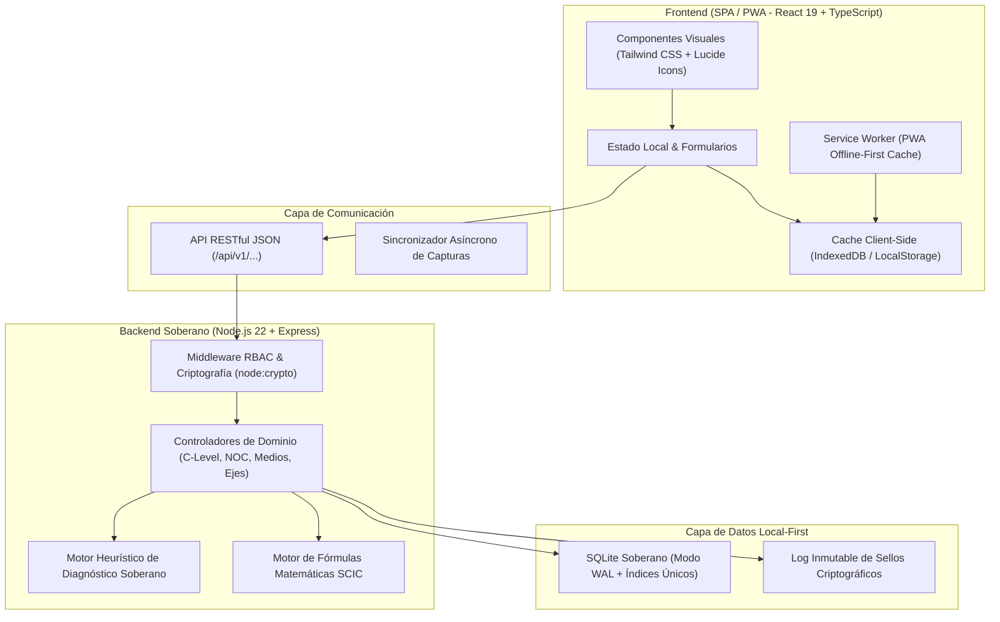

# Documento de Arquitectura y Especificación Técnica (TRD)
## Sistema de Gestión y Despliegue Operativo (SGDO-VSCC)
**Documento:** `ARQUITECTURA_TRD.md`  
**Referencia:** Guía Maestra Institucional — Sección 3 y 4  
**Entorno de Ejecución:** Node.js v22.23.4 / Vite 6 / React 19 / TypeScript 5.8  

---

## 1. Diagrama de Arquitectura de Capas



---

## 2. Tech Stack Fijado y Canónico

| Componente | Tecnología | Justificación Técnica |
| :--- | :--- | :--- |
| **Runtime** | Node.js v22.23.4 (LTS/Current) | Alto rendimiento en I/O, soporte nativo de `node:test`, `node:crypto` y `node:sqlite`. |
| **Frontend Framework** | React 19.0.1 + TypeScript 5.8 | Tipado estricto, renderizado concurrente, ergonomía de componentes. |
| **Bundler & Dev Server** | Vite 6.2.3 | Tiempos de HMR ultrarrápidos (< 50ms) y empaquetado optimizado para producción. |
| **Estilos y UI** | Tailwind CSS v4 + Lucide React | Cero sobrecarga de runtime, clases semánticas, cumplimiento WCAG 2.2. |
| **Gráficos & Mapas** | Recharts 3.10 + Leaflet 1.9 + GeoJSON | Renderizado vectorial preciso de los 335 municipios y polígonos de Venezuela. |
| **Generación de Reportes** | jsPDF 4.2 + jsPDF-AutoTable | Exportación client-side de boletines oficiales sin consumo de CPU en el servidor. |
| **Backend & Servidor API** | Express 4.21.2 + TSX 4.21 | Rutas declarativas RESTful, integración fluida con middleware de Vite. |
| **Persistencia Local** | SQLite (Soberano, modo WAL) | Persistencia local ACID, ultra-ligera, sin requerir servidor externo de BD. |
| **Criptografía** | `node:crypto` nativo | Algoritmos SHA-256 estandarizados para inmutabilidad forense de actas. |

---

## 3. Estructura de Directorios Canónica del Proyecto

```text
sistema-de-gestión-y-despliegue-operativo-mppci/
├── backend/                        # Servicios, Controladores y Persistencia
│   ├── controllers/                # Controladores delgados por dominio
│   ├── middleware/                 # Validación de RBAC, sanitización y auditoría
│   ├── routes/                     # Definición de rutas REST (/api/v1/...)
│   ├── services/                   # Motores heurísticos, sellos criptográficos, SCIC
│   ├── db/                         # Migraciones, esquemas SQLite y seeds
│   └── server.ts                   # Punto de arranque Express y Vite Middleware
├── src/                            # Frontend React 19
│   ├── components/                 # Módulos visuales, formularios y tableros
│   │   └── dashboards/             # Los 5 tableros especializados (C-Level, NOC, etc.)
│   ├── data/                       # Indicadores SCIC, usuarios y vectores geográficos
│   ├── types/                      # Interfaces TypeScript estrictas
│   ├── utils/                      # Motores de fórmulas, exportadores PDF/Excel, permisos
│   └── App.tsx                     # Enrutador principal y control de sesión
├── docs/                           # Inventario Documental Estándar (Guía Maestra)
│   ├── PRD.md                      # Requisitos de Producto
│   ├── 01_ESPECIFICACION_REQUISITOS_SRS.md # Historias Given-When-Then y RNF
│   ├── ARQUITECTURA_TRD.md         # Este documento
│   ├── 03_ESQUEMA_BASE_DATOS_Y_MODELO.md # Tablas e índices de idempotencia
│   ├── 04_DICCIONARIO_DE_DATOS.md  # Catálogo exhaustivo de variables
│   ├── SEGURIDAD_ACCESOS.md        # Matriz RBAC / RACI y políticas de acceso
│   ├── TAREAS_IMPLEMENTACION.md    # Backlog secuencial de fases de mejora
│   └── adr/                        # Registro de Decisiones de Arquitectura
├── tests/                          # Suites de Pruebas Automatizadas
│   ├── unit/                       # Fórmulas SCIC, criptografía SHA-256
│   ├── security/                   # RBAC, matrices de acceso y aislamiento
│   └── integration/                # Endpoints de API y ciclo de captura
└── package.json                    # Scripts oficiales (`dev`, `build`, `test`, `lint`)
```
