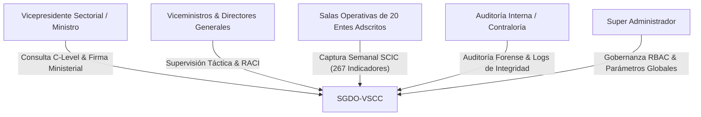

# Documento de Requisitos de Producto (PRD)
## Sistema de Gestión y Despliegue Operativo (SGDO-VSCC)
**Entidad Rectora:** Vicepresidencia Sectorial de Comunicación y Cultura (VSCC) — MIPPCI  
**Versión:** 3.0.0 (Alineada a la Guía Maestra de Ingeniería de Software Institucional)  
**Clasificación:** Confidencial / Estratégico Soberano  

---

## 1. Visión y Propósito Estratégico
El **Sistema de Gestión y Despliegue Operativo (SGDO-VSCC)** es la plataforma digital soberana de inteligencia comunicacional, monitoreo situacional y fiscalización operativa del Estado venezolano. Centraliza la telemetría, métricas de producción de medios, estabilidad del espectro radioeléctrico y despliegue territorial de los 20 entes adscritos a la Vicepresidencia Sectorial de Comunicación y Cultura.

El sistema garantiza que la Máxima Autoridad Ministerial (Ministro/Vicepresidente Sectorial) cuente en tiempo real con un **Tablero Único de Comando C-Level** con métricas consolidadas, sellos criptográficos inmutables y trazabilidad matemática bajo la metodología RACI.

---

## 2. Objetivos del Producto
1. **Soberanía y Autonomía Operativa:** Operar al 100% en infraestructura local/nacional (Air-Gapped / On-Premise) sin dependencias de servicios externos ni telemetría foránea.
2. **Consolidación de los 4 Ejes Estratégicos:**
   - **Eje 1: Medios de Comunicación e Información:** Monitoreo y balance de televisión, radio, prensa impresa, portales digitales y redes sociales.
   - **Eje 2: Plataformas y Espectro:** Estado de telemetría de torres de transmisión TDA/FM (REDTV) e inspecciones/fiscalización del espectro (CONATEL).
   - **Eje 3: Gestión de Comunicaciones:** Monitoreo de matrices de opinión, semáforo de contingencia e Índice de Vulnerabilidad Informativa (IVI).
   - **Eje 4: Gestión Estratégica MIPPCI:** Despliegue institucional en los 335 municipios del país y ejecución presupuestaria/operativa.
3. **5 Tableros Especializados Interconectados:**
   - **C-Level (Ejecutivo):** 8 Macro-indicadores presidenciales con firma y refrendo digital SHA-256.
   - **Ciberdefensa:** Matriz de amenazas, guerra híbrida y contingencia narrativa.
   - **NOC Operatividad:** Telemetría en tiempo real de torres REDTV, enlace satelital Ku y MTTR.
   - **Digital & Redes:** Resonancia en plataformas digitales y combate contra la desinformación.
   - **Medios:** Pases en vivo, notas de prensa y piezas emitidas en tiempo real.
4. **Cero Confianza e Inmutabilidad Forense:** Garantizar mediante sellos SHA-256 y árboles de Merkle que ningún registro de cierre semanal pueda ser adulterado retrospectivamente.

---

## 3. Actores del Sistema y Perfiles de Usuario

| Rol Institucional | Código RBAC | Responsabilidad Principal |
| :--- | :--- | :--- |
| **Super Administrador** | `SUPER_ADMIN` | Configuración técnica global, altas/bajas de usuarios, auditoría de llaves y desbloqueos. |
| **Máxima Autoridad** | `MINISTRO` | Visualización ejecutiva de alto nivel, simulación estratégica y refrendo semanal. |
| **Viceministros** | `VICEMINISTRO` | Supervisión de ejes operativos asignados, validación táctica y control de gestión. |
| **Directores de Operaciones** | `DIRECTOR_OPERACIONES` | Responsables de carga y veracidad de datos técnicos por cada Ente Adscrito. |
| **Auditor / Contralor** | `AUDITOR_CONTRALOR` | Verificación de inmutabilidad, trazabilidad RACI y consistencia metodológica. |
| **Operador de Ente** | `SALA_OPERATIVA_ENTE` | Carga oportuna de los indicadores asignados en la planilla parametrizada SCIC. |

---

## 4. Indicadores de Éxito del Producto (KPIs)
* **Latencia de Carga Inicial:** < 1.5 segundos en red interna.
* **Disponibilidad Offline:** 100% de operatividad en formularios de captura local ante fallas de red.
* **Integridad Transaccional:** 0 duplicaciones de registros semanales gracias a índices de idempotencia matemática.
* **Cobertura de Auditoría:** 100% de las acciones críticas registradas con firma criptográfica y sello temporal.
