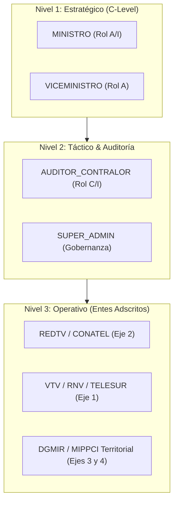

# Matriz de Seguridad, Privilegios RBAC y RACI
## Sistema de Gestión y Despliegue Operativo (SGDO-VSCC)
**Documento:** `SEGURIDAD_ACCESOS.md`  
**Conformidad:** Principio II (Cero Confianza) y Principio IV (Separación de Roles)  

---

## 1. Niveles de Seguridad y Roles RACI

---

## 2. Matriz de Autorización por Módulo (RBAC Matrix)

| Módulo del Sistema | `SUPER_ADMIN` | `MINISTRO` | `VICEMINISTRO` | `AUDITOR` | `SALA_OPERATIVA_ENTE` |
| :--- | :---: | :---: | :---: | :---: | :---: |
| **Tablero C-Level Ejecutivo** | ✅ Total | ✅ Total + Firma | ✅ Consulta | 👁️ Solo Lectura | ❌ Bloqueado |
| **Tableros Especializados (NOC, Ciberdefensa, etc.)** | ✅ Total | ✅ Consulta | ✅ Consulta | 👁️ Solo Lectura | ❌ Bloqueado |
| **Planilla Captura por Ente (SCIC)** | ✅ Total | ❌ Bloqueado | 👁️ Consulta | 👁️ Solo Lectura | ✅ Solo su Ente |
| **Captura Eje 1 (Medios)** | ✅ Total | 👁️ Consulta | 👁️ Consulta | 👁️ Solo Lectura | ✅ Si es Ente Medios |
| **Captura Eje 2 (Plataformas)** | ✅ Total | 👁️ Consulta | 👁️ Consulta | 👁️ Solo Lectura | ✅ Solo REDTV/CONATEL |
| **Captura Eje 3 (Gestión Comunicacional)** | ✅ Total | 👁️ Consulta | 👁️ Consulta | 👁️ Solo Lectura | ✅ Solo Entes Autorizados |
| **Captura Eje 4 (MIPPCI Territorial)** | ✅ Total | 👁️ Consulta | 👁️ Consulta | 👁️ Solo Lectura | ✅ Central / CONATEL |
| **Gestión de Usuarios & Roles** | ✅ Total | ❌ Bloqueado | ❌ Bloqueado | 👁️ Solo Lectura | ❌ Bloqueado |
| **Poner a Cero (Reset) / Carga Masiva** | ✅ Total | ❌ Bloqueado | ❌ Bloqueado | ❌ Bloqueado | ❌ Bloqueado |
| **Auditoría RACI & Sellos SHA-256** | ✅ Total | ✅ Consulta | ✅ Consulta | ✅ Fiscalización | 👁️ Solo su historial |

---

## 3. Políticas de Protección y Cero Confianza

1. **Aislamiento en Red:** El sistema opera en intranet institucional sin acceso directo de salida a internet público.
2. **Defensa en Profundidad:** Las restricciones de acceso se aplican en dos capas independientes:
   - **Capa Cliente (Frontend):** Menús y rutas se ocultan dinámicamente y se bloquea la navegación con pantalla de `Acceso Denegado`.
   - **Capa Servidor (Backend Middleware):** Los endpoints `/api/...` rechazan con código `HTTP 403 Forbidden` cualquier petición cuyo token o cédula no posea los permisos explícitos requeridos.
3. **Inmutabilidad de Sellos:** Los registros con firma SHA-256 no admiten operaciones `UPDATE` o `DELETE` bajo ninguna circunstancia.
