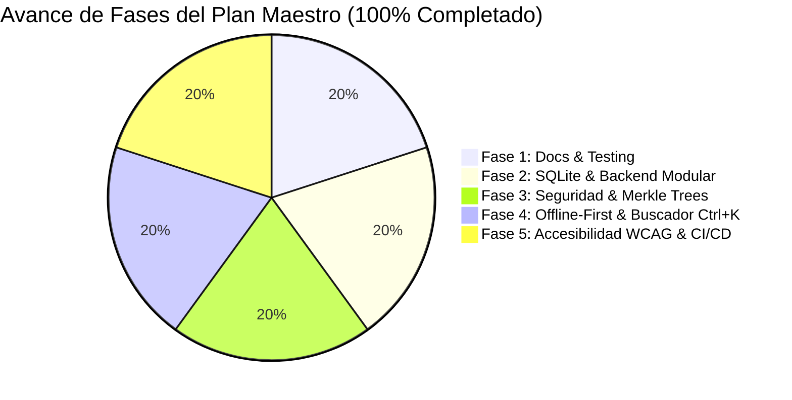

# Backlog Secuencial de Tareas de Implementación
## Sistema de Gestión y Despliegue Operativo (SGDO-VSCC)
**Documento:** `TAREAS_IMPLEMENTACION.md`  
**Objetivo:** Plan de ejecución atómico y progresivo alineado a la Guía Maestra Institucional  
**Estado:** 100% Completado (5 de 5 Fases Ejecutadas y Verificadas)

---

## Estado General del Roadmap

---

### Fase 1: Puertas de Calidad y Estandarización Documental (Completada con Éxito)
- [x] **T-1.1:** Creación del corpus documental institucional en `docs/` (`PRD.md`, `01_SRS.md`, `ARQUITECTURA_TRD.md`, `03_ESQUEMA_BD.md`, `04_DICCIONARIO.md`, `SEGURIDAD_ACCESOS.md`).
- [x] **T-1.2:** Creación de registro inicial de decisiones de arquitectura (`docs/adr/ADR-0001-adopcion-sqlite-y-node-test.md`).
- [x] **T-1.3:** Configuración del comando oficial `npm test` en `package.json` utilizando el ejecutor nativo de Node.js v22 con `tsx`.
- [x] **T-1.4:** Creación de suite unitaria de Fórmulas SCIC (`tests/unit/scic-formula.test.ts`).
- [x] **T-1.5:** Creación de suite unitaria de Integridad Criptográfica SHA-256 (`tests/unit/crypto-hash.test.ts`).
- [x] **T-1.6:** Creación de suite de Seguridad y Aislamiento RBAC (`tests/security/rbac-permissions.test.ts`).
- [x] **T-1.7:** Ejecución y verificación del 100% PASS en las suites automatizadas (15 tests en 3 suites).

---

### Fase 2: Persistencia Soberana SQLite y Modularización del Backend (Completada con Éxito)
- [x] **T-2.1:** Migración modular de `server.ts` hacia `backend/server.ts`, `backend/routes/`, `backend/controllers/` y `backend/services/`.
- [x] **T-2.2:** Creación del motor de persistencia SQLite local (`backend/db/database.ts` y `backend/db/sqliteStore.ts`) con tablas de cortes, capturas, indicadores y sellos.
- [x] **T-2.3:** Implementación de índices únicos para idempotencia en captura semanal (`UNIQUE(corte_id, ente_id)` y `idempotency_key UNIQUE`).
- [x] **T-2.4:** Pruebas de integración de persistencia ante reinicio del servicio con 100% PASS (19 tests en 4 suites).

---

### Fase 3: Seguridad Criptográfica y Trazabilidad Anti-repudio (Completada con Éxito)
- [x] **T-3.1:** Implementación del generador formal de Árboles de Merkle (RFC 6962) para auditoría de planillas e indicadores (`backend/services/merkleService.ts`).
- [x] **T-3.2:** Endpoints seguros de autenticación en backend (`/api/v1/auth/login`, `/api/v1/auth/session`, `/api/v1/auth/logout`) con tokens HMAC-SHA256 y expiración estricta (`backend/services/tokenService.ts`).
- [x] **T-3.3:** Middleware backend de autorización estricta RBAC por endpoint (`backend/middleware/authMiddleware.ts`).
- [x] **T-3.4:** Integración del formulario de inicio de sesión (`LoginModule.tsx`) con la API de autenticación y contingencia local-first.
- [x] **T-3.5:** Suite de pruebas automatizadas de seguridad criptográfica y verificación de árboles de Merkle con 100% PASS (29 tests en 6 suites).

---

### Fase 4: Resiliencia Offline-First y Búsqueda Instantánea Pinpointer (Completada con Éxito)
- [x] **T-4.1:** Configuración de Progressive Web App (PWA): `public/manifest.json` y Service Worker `public/sw.js` con estrategias diferenciadas (`CacheFirst` para activos estáticos locales y `NetworkFirst` con fallback fuera de línea para endpoints API).
- [x] **T-4.2:** Resiliencia y almacenamiento de borradores en IndexedDB local (`src/utils/offlineStore.ts`) con sincronización bidireccional automática al restablecer conectividad.
- [x] **T-4.3:** Buscador Spotlight universal en memoria `Ctrl+K Pinpointer` (`src/components/PinpointerModal.tsx`) con indexación instantánea (< 1ms) de los 267 indicadores oficiales SCIC, tableros especializados, entes adscritos y módulos operativos.
- [x] **T-4.4:** Suites de pruebas automatizadas para resiliencia offline (`tests/unit/offline-resilience.test.ts`) y búsqueda Pinpointer (`tests/unit/pinpointer-index.test.ts`) con 100% PASS (35 tests en 8 suites).

---

### Fase 5: Accesibilidad Universal (WCAG 2.2 AA) y Automatización de Calidad CI/CD (Completada con Éxito)
- [x] **T-5.1:** Auditoría y aseguramiento de contraste de color (mínimo 4.5:1), enlaces de salto (`#main-content`) y estilos universales para navegación por teclado (`:focus-visible` accesible) en `src/index.css` y `src/App.tsx`.
- [x] **T-5.2:** Adaptación de interfaces a usuarios con sensibilidad motriz y vestibular mediante soporte nativo `@media (prefers-reduced-motion: reduce)`.
- [x] **T-5.3:** Atributos semánticos ARIA en modales (`role="dialog"`, `aria-modal="true"`, `aria-labelledby`, `role="combobox"`, `role="listbox"`, `aria-live="polite"`).
- [x] **T-5.4:** Script de Puerta de Calidad Institucional (`scripts/quality_gate.js` y `npm run quality-gate`) para validación obligatoria previa a liberaciones (Tipado estricto + Tests + DB + Docs).
- [x] **T-5.5:** Pipeline de Integración Continua (CI/CD) para GitHub Actions (`.github/workflows/ci.yml`) configurado sobre Node.js v22 con control de calidad automatizado.

---

### Módulo Especial: Formalización Multi-Dispositivo de Beneficiarios y Recuperación de Contraseñas (Completada con Éxito)
- [x] **T-E.1:** Carga de fotografía del usuario con compatibilidad total multi-dispositivo: selección desde cámara web en vivo WebRTC, cámara rápida móvil (`capture="user"`) y selector de galería o archivo local (`PhotoCaptureModal.tsx`).
- [x] **T-E.2:** Hashing de contraseñas de alta seguridad con `scrypt` (RFC 7914, N=16384, r=8, p=1, sal aleatoria de 16 bytes y comparación `timingSafeEqual`) y vinculación criptográfica de dispositivo (`bound_device_id`).
- [x] **T-E.3:** Autoservicio de Recuperación de Contraseñas en dos pasos: Paso 1 con cotejo estricto de nómina oficial (Cédula + Correo/Teléfono) emitiendo código OTP de 6 dígitos y token temporal HMAC-SHA256 (15 min); Paso 2 con reasignación directa de contraseña y desbloqueo de cuenta (`PasswordRecoveryModal.tsx`).
- [x] **T-E.4:** Panel de Gestión Administrativa para Directores (`UserManagementPanel.tsx`): columna de formalización con badges (`PRECARGADO`, `ENROLADO`, `BLOQUEADO`), visualización de foto de perfil, etiqueta de dispositivo vinculado, modal de cambio manual de contraseña y acción para forzar re-enrolamiento.
- [x] **T-E.5:** Suites de pruebas automatizadas de seguridad criptográfica y persistencia SQLite (`tests/security/user-enrollment-crypto.test.ts`) con 43 pruebas en 11 suites con 100% PASS.
