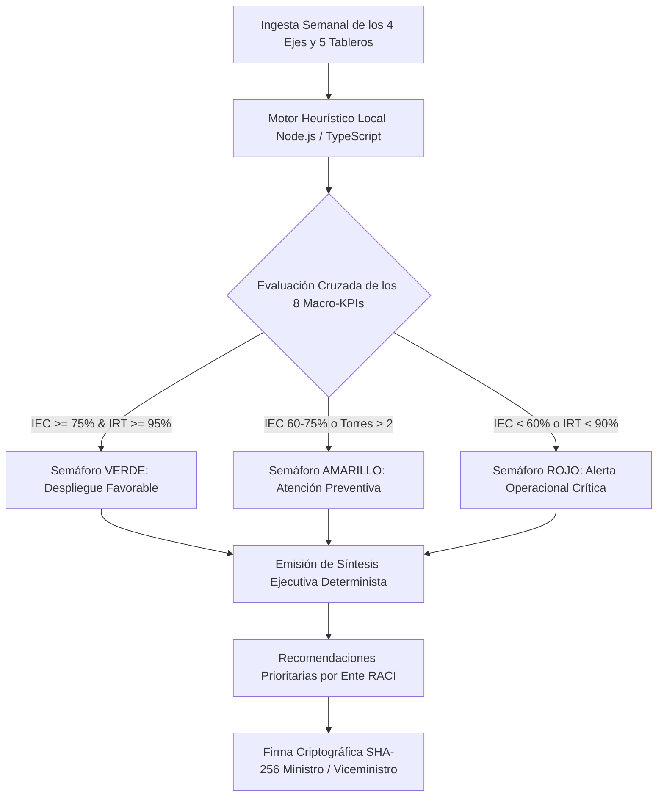

# República Bolivariana de Venezuela
## Vicepresidencia Sectorial de Comunicación y Cultura (VSCC)
### Ministerio del Poder Popular para la Comunicación e Información (MPPCI)
#### Sistema de Gestión y Despliegue Operativo (SGDO-VSCC v2.6 Enterprise)

---

# Alternativas para un Diagnóstico Estratégico 100% Soberano sin Gemini

## Introducción y Doctrina de Seguridad de la Información

El presente documento técnico establece los lineamientos metodológicos y arquitectónicos para garantizar la **independencia tecnológica, soberanía de datos y seguridad de Estado** en el procesamiento del **Diagnóstico Estratégico Automatizado** dentro del Sistema de Gestión y Despliegue Operativo (SGDO-VSCC). 

En el ámbito de la comunicación estratégica gubernamental, la eliminación de dependencias de interfaces de programación (APIs) de corporaciones tecnológicas foráneas (como Google Gemini) constituye un principio ineludible para preservar la confidencialidad de las evaluaciones de entorno, evitar la fuga o perfilamiento de matrices de opinión antes de su emisión oficial, y garantizar la operatividad ininterrumpida en redes cerradas o desconectadas de internet (*air-gapped*).

---

## 1. Motor Analítico Heurístico y Determinista (Recomendado)

En lugar de un modelo probabilístico externo, el diagnóstico se genera a través de un **Motor de Reglas y Árboles de Decisión Institucionales** ejecutado 100% en el servidor local.

### Cómo opera
El sistema evalúa matemáticamente los **8 Macro-indicadores** de mando institucional comparándolos contra sus metas preestablecidas y umbrales normativos de alerta (*Normal*, *Atención*, *Crítico*):

| N° | Código | Macro-Indicador | Ponderación / Meta | Umbral Atención | Umbral Crítico |
| :---: | :---: | :--- | :---: | :---: | :---: |
| 1 | **IEC** | Índice de Efectividad Comunicacional (KPI Maestro) | $\ge 75.0\%$ | $60.0\% - 74.9\%$ | $< 60.0\%$ |
| 2 | **IRT** | Índice de Resiliencia Técnica Nacional (REDTV/TDA) | $\ge 95.0\%$ | $90.0\% - 94.9\%$ | $< 90.0\%$ |
| 3 | **ICD** | Índice de Cobertura Digital y Penetración | $\ge 70.0\%$ | $55.0\% - 69.9\%$ | $< 55.0\%$ |
| 4 | **EE** | Tasa de Engagement Efectivo Ecosistema Redes | $\ge 7.5\%$ | $5.0\% - 7.4\%$ | $< 5.0\%$ |
| 5 | **IBS** | Índice de Balance de Sentimiento Neto | $\ge +20.0\text{ pts}$ | $0.0 - +19.9\text{ pts}$ | $< 0.0\text{ pts}$ |
| 6 | **TRMD** | Tiempo Promedio de Respuesta a Desinformación | $\le 60\text{ min}$ | $61 - 90\text{ min}$ | $> 90\text{ min}$ |
| 7 | **IAAE** | Índice de Alineación con Agenda Estratégica | $\ge 85.0\%$ | $70.0\% - 84.9\%$ | $< 70.0\%$ |
| 8 | **IVI** | Índice de Vulnerabilidad Institucional y RRHH | $\le 0.300$ | $0.301 - 0.400$ | $> 0.400$ |

### Generación de diagnósticos
En función de los cruces de variables (por ejemplo: si el **IRT** cae por debajo del 95% debido a una torre de REDTV, o si el **TRMD** supera los 60 minutos ante una matriz desinformativa), el motor ensambla automáticamente el diagnóstico ejecutivo y emite la recomendación de mando predeterminada y aprobada por el despacho ministerial.

### Ventajas Estratégicas
1. **100% Soberano y Local:** Cero dependencias externas y cero envío de datos o telemetría a servidores foráneos.
2. **Auditable y Reproducible (RACI):** A mismos datos de entrada, el dictamen es exacto, matemático y predecible, sin "alucinaciones" de modelos probabilísticos ni variaciones de tono.
3. **Opera Offline:** Funciona en redes internas cerradas, salas situacionales blindadas, intranets militares o ministeriales sin conexión a internet.
4. **Cero Costos Recurrentes:** No genera gastos por consumo de tokens ni requiere suscripciones en divisas a plataformas comerciales.
5. **Latencia Inmediata:** El procesamiento se produce en menos de 10 milisegundos de forma instantánea al consolidar los reportes semanales.

---

## 2. Modelos de Lenguaje Locales / On-Premise (LLM Soberano Auto-Hospedado)

Si en el futuro la institución desea generación de texto mediante procesamiento de lenguaje natural sin que ningún dato salga del territorio venezolano:

- **Infraestructura Requerida:** Se puede instalar un motor de inferencia local de código abierto como **Ollama**, **vLLM** o **llama.cpp** directamente dentro de los servidores físicos del centro de datos del MPPCI.
- **Modelos Compatibles:** Empleo de pesos abiertos de libre descarga y auditoría (como *Llama 3*, *Mistral* o *DeepSeek*).
- **Procesamiento Aislado:** Todo el procesamiento de tokens, vectorización y generación semántica se realiza estrictamente en hardware propio (CPUs de alto rendimiento o aceleradores GPU locales), sin necesidad de cuentas, registros ni conexiones telemáticas con Google u otras empresas extranjeras.

---

## 3. Matriz Discursiva Institucional Paramétrica

Para el generador de contranarrativas frente a matrices de desinformación y campañas de guerra psicológica:

### Arquitectura de Respuesta Inmediata
Se implementa un generador estructurado según el **Manual de Crisis del MPPCI**, el cual garantiza:

1. **Asignación Automática de Vocería Oficial:** Determinación del vocero técnico o político idóneo según la materia afectada y la titularidad del ente adscrito rector:
   - *Telecomunicaciones / Frecuencias:* Dirección General de CONATEL / Sala de Fiscalización.
   - *Transmisión / Señal / Torres:* Presidencia de REDTV / Gerencia de Operaciones Técnicas.
   - *Información / Cobertura de Estado:* Viceministerio de Comunicación e Información / Agencia AVN.
   - *Línea Editorial Política:* Despacho de la Máxima Autoridad / Ministro.
2. **Selección Jerárquica de Canales de Despliegue:** Priorización de emisión escalonada (pases satelitales en vivo en VTV, cadenas de radio RNV/YVKE, cables de urgencia AVN y difusión verificada en canales de mensajería Telegram/WhatsApp).
3. **Plantilla de Desmentido Estructurado:** Redacción institucional estandarizada que incorpora la confirmación técnica en sitio, la denuncia del carácter malicioso del rumor y la exhortación a informarse por canales del SiBCI.

---

## Cuadro Comparativo de Enfoques

| Criterio | Motor Heurístico Soberano (Implementado) | LLM Local On-Premise | API Externa (Gemini / Terceros) |
| :--- | :---: | :---: | :---: |
| **Soberanía y Seguridad de Datos** | **Total (100% Local)** | Total (100% Local) | Vulnerable (Datos viajan al exterior) |
| **Dependencia de Internet** | **Ninguna (Opera Offline)** | Ninguna (Opera Offline) | Absoluta (Falla si se interrumpe el enlace) |
| **Trazabilidad y Fe RACI** | **Determinista y Reproducible** | Probabilístico | Probabilístico y no auditable |
| **Riesgo de Alucinaciones** | **0% (Basado en datos reales)** | Bajo a Medio | Presente |
| **Costo Operativo** | **$0 (Incluido en el sistema)** | Requiere servidor local GPU | Facturación continua por consumo de API |
| **Velocidad de Respuesta** | **< 10 milisegundos** | 2 a 5 segundos | 3 a 10 segundos |

---

*Documento aprobado y archivado en la Dirección General de Tecnología e Información de la VSCC.*  
*Caracas, República Bolivariana de Venezuela.*
