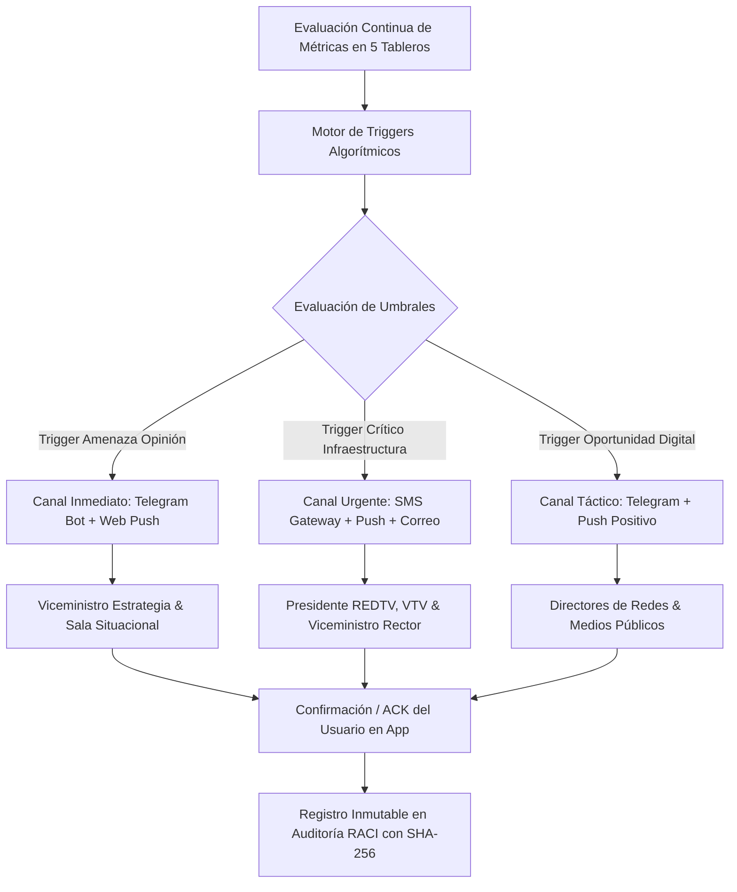

# República Bolivariana de Venezuela
## Vicepresidencia Sectorial de Comunicación y Cultura (VSCC)
### Ministerio del Poder Popular para la Comunicación e Información (MPPCI)
#### Sistema de Gestión y Despliegue Operativo (SGDO-VSCC v2.6 Enterprise)

---

# PLAN MAESTRO: SISTEMA AUTOMATIZADO DE ALERTAS DE IMPACTO (Push Notifications / SMS / Telegram / Email)

## 1. Justificación y Objetivos Estratégicos

Para garantizar un **flujo narrativo institucional proactivo**, resguardar la infraestructura crítica de telecomunicaciones y evitar conexiones de datos inútiles o consumos pasivos de información, el **SGDO-VSCC** incorpora un **Motor Algorítmico de Triggers de Impacto**. 

Este sistema evalúa de forma continua y en tiempo real las métricas capturadas por los **5 Tableros Especializados Interconectados** y los **4 Ejes de Gestión**, despachando alertas inmediatas a los dispositivos de los **Viceministros, Directores Generales y Presidentes de Entes Adscritos** según su perfil en la matriz RACI.

---

## 2. Catálogo Oficial de los Nueve (9) Disparadores (Triggers) Algorítmicos

### Categoría 1: Alertas de Amenaza a la Opinión Pública (Riesgo Reputacional / Fake News)

1. **`TRG-DA01-VIRAL` (Crecimiento Exponencial de Matriz Desestabilizadora):**
   - **Indicador:** `[DA-01]` Tendencias virales desestabilizadoras.
   - **Condición Algorítmica:** Detección de incremento $> 20\%$ en el volumen de menciones/interacciones adversas en un lapso inferior a 60 minutos ($T < 1\text{ h}$).
   - **Nivel de Severidad:** **ALTO**.
   - **Acción Sugerida:** Activar de inmediato la célula de análisis de sentimiento en la Sala Situacional y alertar a los equipos de producción de piezas de respuesta.
   - **Destinatarios RACI:** Viceministro de Planificación y Estrategia Comunicacional (**A**), Director General de Monitoreo e Inteligencia (**R**).
   - **Canales:** Push Inmediato + Telegram.

2. **`TRG-TRMD-TIMEOUT` (Exceso de Tiempo de Respuesta a Desinformación):**
   - **Indicador:** `[TRMD]` Tasa / Tiempo Promedio de Respuesta a Matrices de Desinformación.
   - **Condición Algorítmica:** Transcurso de más de 120 minutos ($T > 2\text{ h}$) desde la categorización de una alerta sin la emisión y carga del comunicado oficial, desmentido o vocería técnica.
   - **Nivel de Severidad:** **CRÍTICO**.
   - **Acción Sugerida:** Escalamiento urgente al Despacho del Ministro para instrucción de vocería obligatoria y pases satelitales en vivo.
   - **Destinatarios RACI:** Máxima Autoridad / Ministro (**I/A**), Viceministros Rectores (**A**).
   - **Canales:** SMS Urgente + Push Prioritario + Telegram.

3. **`TRG-ID09-SENT` (Caída Crítica de Sentimiento Digital):**
   - **Indicador:** `[ID-09]` Sentimiento digital global de la gestión.
   - **Condición Algorítmica:** Descenso del ratio de sentimiento favorable por debajo del 30% positivo ($< 30\%$) durante un evento oficial en vivo, cadena nacional o alocución presidencial.
   - **Nivel de Severidad:** **ALTO**.
   - **Acción Sugerida:** Despliegue de contranarrativas y amplificación orgánica en microblogging y transmisiones streaming.
   - **Destinatarios RACI:** Viceministro de Estrategia Comunicacional (**A**), Directores de Redes Digitales (**R**).
   - **Canales:** Telegram + Push Inmediato.

---

### Categoría 2: Alertas de Contingencia de Infraestructura y Master (Nivel Crítico)

4. **`TRG-RTV01-TDA` (Afectación de Cobertura TDA Nacional o Caída de Nodo):**
   - **Indicador:** `[RTV-001]` Operatividad de la Televisión Digital Abierta (TDA).
   - **Condición Algorítmica:** Caída de la operatividad global nacional por debajo del 95% ($< 95\%$) o interrupción total de transmisión en cualquier nodo o torre estratégica regional (ej. Puerto Cabello, Curimagua, Cerro El Ávila).
   - **Nivel de Severidad:** **CRÍTICO**.
   - **Acción Sugerida:** Despacho de cuadrillas técnicas de REDTV en coordinación con CORPOELEC y activación de redundancia de señal.
   - **Destinatarios RACI:** Presidente de REDTV (**R**), Viceministro de Soporte Operativo (**A**), Dirección General de Tecnología (**C**).
   - **Canales:** SMS Gateway + Push Crítico + Telegram.

5. **`TRG-RTV09-SAT` (Micro-cortes o Degradación de Banda Ku / Satelital):**
   - **Indicador:** `[RTV-009]` Disponibilidad de enlace satelital.
   - **Condición Algorítmica:** Detección de atenuación de portadora, micro-cortes reiterados ($> 3$ en 15 min) o pérdida de potencia en Banda Ku que comprometa las señales matrices de televisión abierta (VTV, TELESUR, TVES).
   - **Nivel de Severidad:** **CRÍTICO**.
   - **Acción Sugerida:** Conmutación a telepuerto secundario o enlace fibra óptica de respaldo y calibración de uplink.
   - **Destinatarios RACI:** Presidente de VTV (**R**), Presidente de TELESUR (**R**), Gerencia de Telepuerto REDTV (**R**).
   - **Canales:** Telegram + Push Inmediato + Correo Institucional.

6. **`TRG-TMR-ESCALA` (Tiempo Medio de Recuperación Excedido - Escalamiento de Ticket):**
   - **Indicador:** `[TMR]` Tiempo Medio de Recuperación de Incidencias Técnicas.
   - **Condición Algorítmica:** Incidencia técnica en infraestructura que permanezca en estatus no resuelto por más de 4 horas ($TMR > 4\text{ h}$).
   - **Nivel de Severidad:** **ALTO (Escalamiento Automático)**.
   - **Acción Sugerida:** Convocatoria de comité de crisis técnica e informe extraordinario para el Viceministro.
   - **Destinatarios RACI:** Viceministro Revisor (**A**), Auditor Contralor (**C**).
   - **Canales:** Correo Ejecutivo Detallado + Push.

---

### Categoría 3: Alertas de Tráfico, Interacciones y Despliegue (Alertas Positivas y de Oportunidad)

7. **`TRG-STR01-LIVE` (Pico de Concurrencia Sobresaliente en Streaming):**
   - **Indicador:** `[STR-001]` Pico de Concurrencia Simultánea (PCV).
   - **Condición Algorítmica:** Trasmisión en vivo que supere en más de un 50% ($> +50\%$) el promedio histórico móvil de los últimos 30 días.
   - **Nivel de Severidad:** **OPORTUNIDAD COMUNICACIONAL**.
   - **Acción Sugerida:** Notificar a las salas de redacción para extender la cobertura, generar pases complementarios y republicar cortes en redes sociales.
   - **Destinatarios RACI:** Viceministro de Estrategia (**A**), Directores Generales de Medios Digitales (**R**).
   - **Canales:** Push Positivo + Telegram.

8. **`TRG-RED-ENG` (Alta Tracción y Viralidad de Campaña Institucional):**
   - **Indicador:** `[RED-ENG]` Tasa de Engagement Efectivo en Redes Sociales.
   - **Condición Algorítmica:** Campaña o etiqueta institucional que supera el umbral de viralidad orgánica ($EE > 12\%$).
   - **Nivel de Severidad:** **OPORTUNIDAD COMUNICACIONAL**.
   - **Acción Sugerida:** Autorizar republicación cruzada en todas las cuentas oficiales del Sistema Nacional de Medios Públicos y medios aliados.
   - **Destinatarios RACI:** Directores de Medios Públicos (VTV, RNV, YVKE, AVN), Equipo de Redes Sociales del MPPCI.
   - **Canales:** Telegram + Push.

9. **`TRG-TV08-PASE-LOW` (Déficit de Cobertura en Zonas de Crisis / Desastres):**
   - **Indicador:** `[TV-008]` Cantidad de Pases Satelitales/IP en Vivo desde Regiones.
   - **Condición Algorítmica:** Detección de menos de 2 pases informativos por turno desde un municipio o estado declarado en contingencia climática o evento de seguridad.
   - **Nivel de Severidad:** **ALERTA TÁCTICA**.
   - **Acción Sugerida:** Instruir al Viceministerio de Gestión Comunicacional para ordenar el despliegue inmediato de unidades móviles o corresponsales populares en territorio.
   - **Destinatarios RACI:** Viceministro de Gestión Comunicacional (**A**), Directores de Prensa y Servicios Informativos (**R**).
   - **Canales:** Push + Correo Electrónico.

---

## 3. Matriz de Gobernanza RACI y Canales de Difusión

---

## 4. Política Anti-Fatiga de Alertas (*Debouncing* y Agregación)

Para evitar la saturación de los dispositivos móviles ministeriales, se aplican las siguientes reglas:

1. **Ventana de Supresión Temporal (*Debounce Window*):** Una misma alerta no puede disparar notificaciones push o SMS con una frecuencia menor a 30 minutos, salvo que el nivel de severidad se incremente de `ALTO` a `CRÍTICO`.
2. **Hilo de Incidencia y Auto-Cierre:** Cuando el indicador se normaliza (ej. el nodo de REDTV restablece su potencia o el desmentido es publicado), el sistema emite una notificación de cierre (*RESOLUCIÓN: Incidencia Subsanada*) y archiva el ticket.
3. **Escalamiento Progresivo:** Si una alerta crítica no registra lectura o acción de gestión (*ACK*) dentro de los primeros 15 minutos, el motor despacha un SMS directo al Viceministro o Autoridad Superior.

---

## 5. Cronograma y Estado de Implementación Técnica (Fases 1 a 4)

| Fase | Alcance y Entregables | Estado | Archivos / Componentes Involucrados |
| :--- | :--- | :---: | :--- |
| **Fase 1: Backend & Motor Heurístico** | Tipos TypeScript, almacén de incidentes en memoria, función evaluadora con debouncing de 30m, escalación a 15m y 5 endpoints REST (`active-incidents`, `evaluate-triggers`, `ack`, `resolve`, `test-dispatch`). | **COMPLETADA (100%)** | `src/types/alertsImpactTypes.ts` `server.ts` `npm run lint` (0 errores) |
| **Fase 2: Interfaz de Mando (UI)** | Bandeja visual de incidentes de impacto en tiempo real, insignia de severidad/RACI, botones de confirmación (*ACK*) y formulario de resolución en el **Tablero 5 (C-Level)** y en el **Centro de Notificaciones**. | **PENDIENTE (PRÓXIMA)** | `src/components/CLevelExecutiveView.tsx` `src/components/AlertsNotificationCenter.tsx` |
| **Fase 3: Despachadores Multicanal** | Conectores a Web Push Notifications, Bot Institucional de Telegram y simulación de gateway SMS para celulares de viceministros. | **PENDIENTE** | `server.ts` `src/services/notificationService.ts` |
| **Fase 4: Auditoría Criptográfica** | Sellado SHA-256 de cada confirmación/resolución en el libro inmutable de auditoría RACI y configuración de preferencias por usuario. | **PENDIENTE** | `src/components/AuditTraceabilityPanel.tsx` |

---

## 6. Instrucciones de Continuidad para la Próxima Sesión

Para retomar el proyecto exactamente en este punto sin perder contexto ni duplicar trabajo, al abrir la nueva sesión simplemente escribe el siguiente comando o mensaje:

> **"Continuar con la Fase 2 del PLAN MAESTRO - SISTEMA AUTOMATIZADO DE ALERTAS DE IMPACTO (documentado en documentos/documentación/PLAN MAESTRO - SISTEMA AUTOMATIZADO DE ALERTAS DE IMPACTO.md). La Fase 1 ya fue completada y validada en server.ts y src/types/alertsImpactTypes.ts."**

---

*Aprobado para ejecución en el Sistema de Gestión y Despliegue Operativo (SGDO-VSCC).*  
*Caracas, República Bolivariana de Venezuela.*
